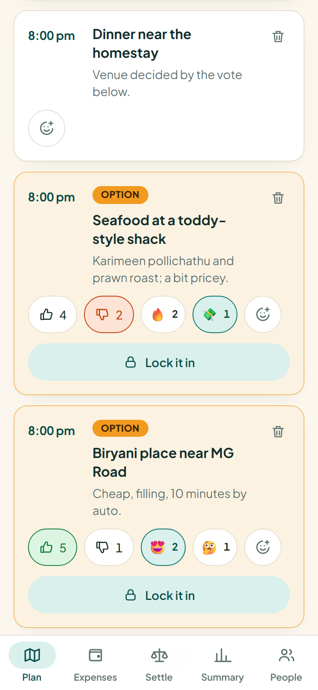
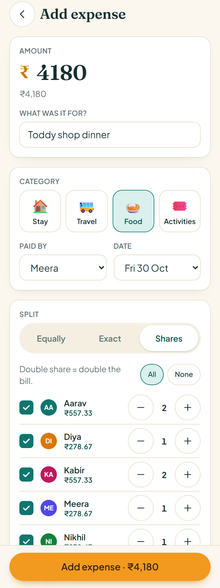
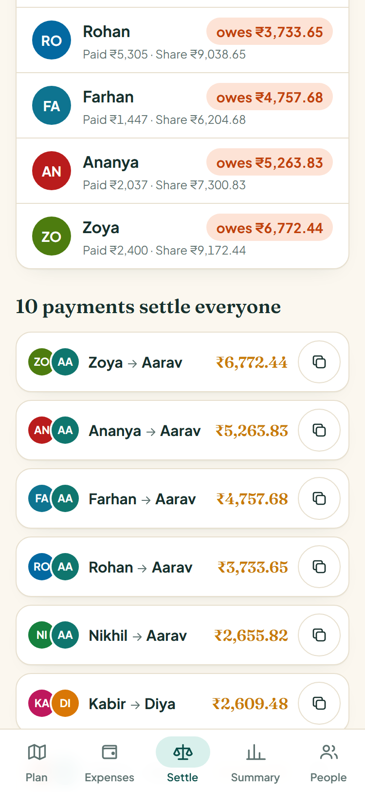
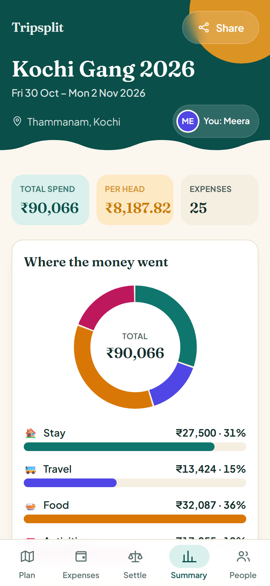

# Tripsplit

Plan the trip, split the bill, stay friends. Tripsplit is a group-trip planner and cost splitter
for Indian friend groups: a day-by-day plan the group can vote on, expenses in rupees with every
kind of split people actually use, and a settle-up screen that gives you the fewest UPI payments
that square everyone up.


## The problem

I'm going to Kochi with 11 friends from 30 Oct to 2 Nov 2026. We're staying in Thammanam, doing a
Munnar day trip on the Saturday and Alleppey (backwaters, then a toddy shop) on the Sunday. The
planning happened the way it always does: a WhatsApp group, a Google Sheet somebody made at 1am,
a poll that got buried under 200 messages, and a running argument about who owes whom for the
autos.

The splitting is where it really falls apart. Splitwise exists, but it asks all 11 people to
install an app and make an account before anyone can log a ₹40 chai, and in practice two people
do and the rest never open it. And a lot of trip spending is not "divide by 11":

- One friend skipped Munnar, so the bus, breakfast and lunch that day were split 10 ways.
- Only six people went on the jeep safari, five went kayaking.
- At the toddy shop the drinkers ate and drank roughly double, so they should pay double shares.
- Someone paid for lunch where everyone ordered different things, so it's exact amounts.

So the brief I gave myself: everything has to work from a link dropped into the WhatsApp group,
on a phone, with no sign-up, and the maths has to handle those four cases without anyone opening
a calculator.

## What it does

- **Trips without accounts.** Create a trip (name, dates, base location, members) and share the
  link. Anyone with it can open the trip, tap their name once ("Who are you?") and they're in.
  Identity is a per-trip cookie. Share goes through the phone's share sheet or straight to
  WhatsApp.
- **Day-by-day plan with voting.** Each day has its plans (time, place, notes). Anything can be
  posted as an option instead of a plan, and people vote 👍/👎 and react (🔥 😍 😴 💸 🤔). When the
  group has decided, anyone can lock an option in and it becomes part of the plan.
- **Expenses in INR.** Who paid, how much, category (stay, travel, food, activities), which day,
  and how to split it: equally, by exact amounts, or by shares, among everyone or only the people
  who were there. Exact mode shows a live "₹X left to assign", shares mode previews the per-head
  amount as you tap.
- **Settle up.** Everyone's balance (paid minus share), then the minimum number of payments that
  settles the whole group, each as a copyable line like `Zoya pays Aarav ₹6,772.44`. "Copy all"
  and "Send on WhatsApp" post the whole list to the group. If the person being paid has added a
  UPI id, there's a "Pay via UPI" button that opens their UPI app with the amount filled in.
- **Summary.** Total spend, per-head average, spend by category as a donut chart, what each person
  consumed against what they paid, and spend per day.

| Plan and voting | Add an expense | Settle up | Summary |
| --- | --- | --- | --- |
|  |  |  |  |

The demo trip (`/t/kochi-2026`) is the real Kochi plan with made-up names: 11 people, 26 plan
items across the four days and 25 expenses adding up to ₹90,066.

## Approach

### Money is integers

Every amount is stored and computed in paise, as integers. ₹100 split three ways is 3334 + 3333 +
3333 paise, never 33.333... The leftover paise from an equal or shares split go out by the
largest-remainder method, so the parts always add back to the exact total, and ties go to members
in a fixed order (by id) so the form's preview and the saved result never disagree by a paisa.

### Splits are weights

All three split modes are stored the same way, as one row per included person with a weight:

| Mode | Weight means | Example |
| --- | --- | --- |
| Equally | 1 for each person included | Munnar bus: 10 rows, Farhan not included |
| Shares | number of shares | Toddy dinner: drinkers 2, everyone else 1 |
| Exact | that person's amount in paise | Fort Kochi lunch: 22000, 18500, ... |

"Only some members" is not a fourth mode. It is just who has a row. That kept the schema to one
table and the maths to one function (`computeShares` in [src/lib/split.ts](src/lib/split.ts)).

### Settle-up is an exact minimum, not greedy

The usual approach (and the one most splitter tutorials use) is greedy: biggest debtor pays
biggest creditor, repeat. It's simple and never needs more than n - 1 payments, but it isn't
always minimal. With balances of +₹6, +₹7, -₹4, -₹6, -₹3, greedy makes 4 payments, and 3 are
enough because the +₹6 and -₹6 people can settle between themselves.

The real minimum is (number of people with a non-zero balance) - (the largest number of separate
groups whose balances each add up to zero). Finding those groups is a subset problem, so
[src/lib/settle.ts](src/lib/settle.ts) runs a bitmask DP over the people who owe or are owed
(fine up to 20 of them, which is any real friend group) and then settles each group greedily,
which inside a zero-sum group uses exactly size - 1 payments. Above 20 it falls back to greedy.

Honest note on the demo: it needs 10 payments for 11 people, the maximum, because no smaller
group of balances happens to cancel out (Aarav paid the ₹27,500 homestay, so most of the money
flows back to him). The DP earns its keep on trips where sub-groups do cancel. The tests cover that, including a property test that checks the DP against brute
force on random trips.

### Persistence: Postgres everywhere

Drizzle ORM with one Postgres schema. Locally it runs on [PGlite](https://pglite.dev), which is
real Postgres compiled to WebAssembly and stored in `./.data`, so there's nothing to install and
no Docker. In production `DATABASE_URL` points at Neon and the same schema and migrations run
there over Neon's HTTP driver. Multi-step writes (saving an expense and its splits) are atomic on
both: a transaction on PGlite, `db.batch()` on Neon, which runs as one transaction over HTTP.

### No accounts, on purpose

For a v1 that lives in a WhatsApp group, sign-up is the thing that kills adoption, so the share
link is the permission. Anyone with the link can view and edit, the way a shared Google Sheet
works for most groups today. Server actions still check that every id in a request belongs to the
trip in the URL, so a link to one trip can't touch another.

### Stack

Next.js 16 (App Router, Server Components, Server Actions, Cache Components), React 19,
TypeScript, Tailwind CSS v4, Drizzle ORM, PGlite / Neon, Vitest. The charts are hand-rolled SVG
and CSS, with no chart library.

## Running it locally

Needs Node 20.9 or newer.

```bash
npm install
npm run db:setup
npm run dev
```

`db:setup` applies the migrations and seeds the demo trip. Open http://localhost:3000 and hit
"Open the demo trip", or go straight to http://localhost:3000/t/kochi-2026. Run `npm run db:seed`
again any time to reset the demo.

```bash
npm test
```

runs the unit tests for the money, split, balance, settle-up and summary maths (Vitest).

## Deploying to Vercel with Neon

1. Create a free project at [neon.tech](https://neon.tech) and copy its connection string
   (`postgresql://...`).
2. Copy `.env.example` to `.env.local` and set `DATABASE_URL=postgresql://...`, then run
   `npm run db:setup` once.
   That creates the tables in Neon and seeds the demo trip.
3. Push the repo to GitHub and import it at [vercel.com/new](https://vercel.com/new). The framework
   preset is detected as Next.js, no build settings to change.
4. In the Vercel project, add `DATABASE_URL` under Settings → Environment Variables (Production and
   Preview), plus `NEXT_PUBLIC_SITE_URL` set to your live URL (for example
   `https://tripsplit.vercel.app`) so WhatsApp link previews point at the right site. Then deploy.

Without `DATABASE_URL` the app refuses to start on Vercel instead of quietly using a throwaway
local database. When the schema changes, run `npm run db:generate`, commit the new file in
`drizzle/`, and run `npm run db:migrate` with the Neon `DATABASE_URL` set.

## Project layout

```
src/lib/        pure maths: money, split, balances, settle, summary (+ __tests__)
src/db/         schema, connection (PGlite or Neon), queries, migrate, seed, demo data
src/app/        pages and server actions (/t/[slug] and its tabs)
src/components/ UI pieces: tab bar, identity picker, expense form, charts
drizzle/        generated SQL migrations
```

## Project docs

- [PRD](docs/prd.md): problem, personas, user stories with acceptance criteria, success metrics.
- [Architecture](docs/architecture.md): data model, request flow, the money and settle-up maths.
- [Design](docs/design.md): visual language, screens, states and accessibility.
- [Phases](docs/phases.md): what was built, and what comes next in what order.
- [Rules](docs/rules.md): working rules for anyone (or any AI agent) changing the code.
- [Memory](docs/memory.md): decision log, gotchas and current state.

## What I'd build next

- **Mark a payment as done.** Right now settle-up tells you who pays whom, but there's no way to
  record "Riya paid Arjun" and have it drop off the list. It would be a `settlements` table that
  feeds into the balances, and it's the first thing the Kochi group would ask for.
- **Round to whole rupees.** Nobody sends ₹6,772.44 on UPI. A toggle that rounds each payment and
  shows the few paise of drift would match how people actually pay.
- **A change log.** With no accounts, anyone can edit anything. A simple "Kabir changed Munnar
  lunch from ₹4,687 to ₹4,867" feed would make that trust model safer, and an undo would make it
  forgiving.
- **Live updates.** Pages refresh on your own actions, but you don't see a friend's new expense
  until you reload. Polling or server-sent events would fix that.
- **Receipt photos and quick add.** Snap the bill, or type "450 chai Meera" into one box.
- **Optional trip PIN** for groups that don't want an open link floating around.
