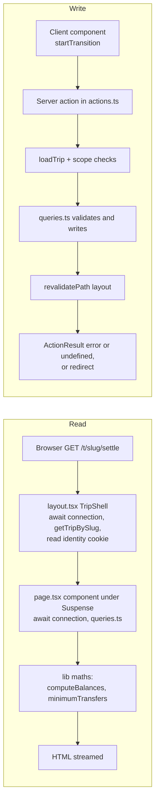
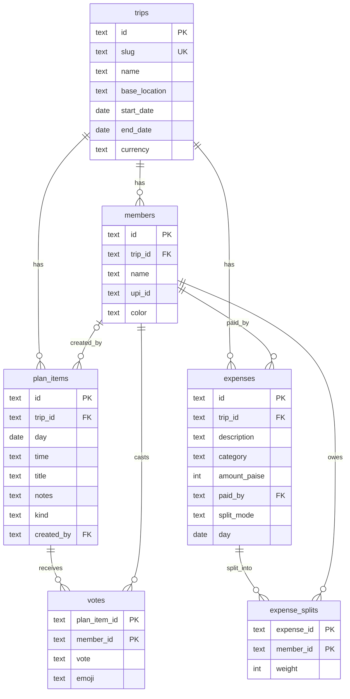
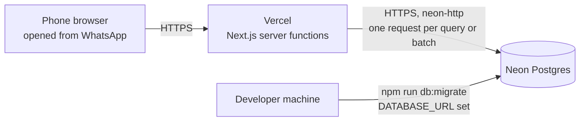

# Tripsplit: architecture

How the app is built and why. For what it does see [prd.md](prd.md); for the rules for changing it see [rules.md](rules.md); for setup see the [README](../README.md).

## Stack

| Layer | Choice | Version (from [package.json](../package.json)) |
| --- | --- | --- |
| Framework | Next.js App Router, Server Components, Server Actions, Cache Components | 16.4.3 |
| UI | React, Tailwind CSS v4 (via `@tailwindcss/turbopack`), hand-written SVG icons and charts | React 19.3.0, Tailwind ^4 |
| Fonts | `next/font/google`: Plus Jakarta Sans and Fraunces | fetched at build, self-hosted at runtime |
| Language | TypeScript, strict | ^5 |
| ORM and migrations | Drizzle ORM, drizzle-kit | 0.45.x, 0.31.x |
| Database, local | PGlite (Postgres compiled to WASM), data in `./.data/pglite` | ^0.5.11 |
| Database, production | Neon over HTTP (`@neondatabase/serverless`, `drizzle-orm/neon-http`) | ^1.2.0 |
| Tests | Vitest, node environment | ^5.0.5 |
| Scripts | `tsx` for migrate and seed | ^4.23.15 |
| Lint | ESLint 9 with `eslint-config-next` | 16.4.3 |
| Runtime | Node 20.9 or newer | `engines` in package.json |

Runtime dependencies are six: `next`, `react`, `react-dom`, `drizzle-orm`, `@neondatabase/serverless`, `@electric-sql/pglite`. There is no chart, icon, date, state or validation library.

[next.config.ts](../next.config.ts) turns on `cacheComponents` and `partialPrefetching`, lists `@electric-sql/pglite` in `serverExternalPackages` (it loads a WASM file by path, so it must not be bundled) and routes `*.css` through the Tailwind Turbopack loader. [AGENTS.md](../AGENTS.md) warns that this Next version differs from older ones and points at the docs shipped in `node_modules/next/dist/docs/`.

## Folder layout

```
src/
  lib/               pure TypeScript, no DB, no React. Every file here has tests.
    money.ts           formatINR, parseINR, MAX_AMOUNT_PAISE
    split.ts           validateSplit, computeShares, SplitError
    balances.ts        computeBalances
    settle.ts          minimumTransfers, greedyTransfers
    summary.ts         summarize
    types.ts           enums as const arrays, Balance, Transfer, MEMBER_COLORS
    errors.ts          UserError
    pg-errors.ts       SQLSTATE to UserError mapping
    guards.ts          isRecord, isOneOf (narrow untrusted input)
    expense-shape.ts   stored expense to maths shape (used by tests only, see limitations)
    __tests__/         7 files, 67 tests
  db/
    schema.ts          Drizzle tables and constraints (one file)
    index.ts           connection switch, lazy proxy, runAtomically
    queries.ts         every read and write the UI uses, plus input cleaning
    migrate.ts         applies drizzle/ with the matching driver
    seed.ts            deletes and recreates the demo trip
    demo-data.ts       the Kochi demo as pure data (shared with tests)
  app/
    layout.tsx         fonts, metadata, viewport
    page.tsx           landing page and create-trip form
    error.tsx, not-found.tsx, icon.svg, globals.css
    t/[slug]/          the trip: layout.tsx (shell), page.tsx (Plan),
                       expenses/, settle/, summary/, people/,
                       actions.ts, identity.ts, maths-input.ts, error.tsx
  components/          client and shared UI (tab bar, header, sheet, forms, charts)
drizzle/               generated SQL migration and snapshot (committed)
docs/                  these documents and screenshots/
```

## Request flow



Reads. Pages are Server Components. Each route file exports a thin component that renders a `<Suspense>` with a skeleton, and an inner async component that starts with `await connection()`, resolves `params`, calls `getTripBySlug` and then the page's own queries (`getExpenses`, `getPlanItems`). The shell (header skeleton, tab bar) is prerendered; trip data streams in. The balance, settle and summary numbers are computed on the server from raw expenses on every request by the pure functions in `src/lib/`. Nothing derived is stored.

Writes. Client components call server actions in [actions.ts](../src/app/t/%5Bslug%5D/actions.ts) inside `startTransition`. Each action loads the trip from the slug, checks that every id in the request belongs to that trip, calls a function in [queries.ts](../src/db/queries.ts) (which validates and writes), then runs `revalidatePath("/t/<slug>", "layout")` so the current route re-renders with fresh data. Actions return `{ error }` for problems the user can fix and `undefined` on success. `saveExpenseAction` and `deleteExpenseAction` `redirect` to the expense list; `createTripAction` returns the typed values with its error so the form is not wiped.

Cache Components. Every request-time read sits under a `<Suspense>` boundary and its component calls `await connection()` first. Without that, the DB read fails during prerender (PGlite uses `Date.now()`, which Next forbids in the static shell). Because of `connection()`, nothing is cached server-side between requests. `generateMetadata` in the trip layout also calls `connection()` and `getTripBySlug`.

Not found. An unknown slug calls `notFound()` after the shell has started streaming, so the response is HTTP 200 with the "Lost the trail" UI rather than a 404 status.

Optimistic UI. Only plan votes and reactions use `useOptimistic` ([plan-item.tsx](../src/components/plan-item.tsx)); the rest wait for the action and the revalidated render.

## Data model

Defined in [schema.ts](../src/db/schema.ts), applied by [drizzle/0000_opposite_blockbuster.sql](../drizzle/0000_opposite_blockbuster.sql). All ids are text UUIDs from `crypto.randomUUID()`. Dates are `date` columns read as plain `YYYY-MM-DD` strings so no timezone can shift a day.



Every table also has `created_at timestamptz default now()` except `votes` and `expense_splits`.

| Constraint | Where | Purpose |
| --- | --- | --- |
| `trips.slug` unique | trips | The URL key |
| unique `(trip_id, lower(name))` | members | Case-insensitive unique names within a trip |
| `kind in ('plan','option')` | plan_items | Enum as check |
| `vote in ('up','down')`, `emoji in (🔥 😍 😴 💸 🤔)` | votes | Enums as checks. Both columns are nullable: one row holds one vote and one emoji. |
| `amount_paise > 0`, category in four values, split mode in three | expenses | Last line of defence behind the app validation |
| `weight >= 0` | expense_splits | Weights are never negative |
| `trip_id` cascades on delete | members, plan_items, expenses | Deleting a trip (the seed does this) removes everything under it |
| `expense_splits.expense_id` and `votes.*` cascade | | Deleting an expense or plan item cleans up |
| `expenses.paid_by`, `expense_splits.member_id` do not cascade | | A member who paid or sits in a split cannot be deleted. `removeMember` checks first and gives a friendly error. |
| `plan_items.created_by` set null | | Removing a member keeps their plan items |

### How split weights encode the modes

Every mode is stored the same way: one `expense_splits` row per included member, with an integer `weight`.

| Mode | Weight means | Example from the demo |
| --- | --- | --- |
| `equal` | Always 1 (the server rewrites any submitted weight to 1) | KSRTC buses to Munnar: 10 rows, one person not included |
| `shares` | Number of shares | Toddy shop dinner ₹4,180: some people 2, others 1 |
| `exact` | That person's amount in paise; rows must sum to `amount_paise` | Fort Kochi lunch ₹2,145 |

"Only some members" is not a fourth mode; it is just which members have a row. A weight of 0 is accepted by the database and by `validateSplit` for shares and exact; that member owes nothing but still counts in "split among N" and cannot be removed.

## Persistence

[db/index.ts](../src/db/index.ts) chooses the driver at import time:

```
DATABASE_URL set        -> drizzle-orm/neon-http over neon()           (production)
else, VERCEL set        -> throw "DATABASE_URL is not set..."          (never lose data silently)
else                    -> mkdir ./.data/pglite, drizzle-orm/pglite    (local)
```

- `usingNeon` is `Boolean(process.env.DATABASE_URL)` and drives the branches in `runAtomically` and `migrate.ts`.
- The Vercel guard exists because Vercel's filesystem is read-only and ephemeral; an embedded database there would pass every smoke test and then lose data.
- The connection is cached on `globalThis` so Next dev hot reloads reuse one handle (PGlite allows one process-wide handle on its directory).
- `db` is a lazy `Proxy`: the connection opens on first property access, not on import. `next build` workers import the module and must not open, and lock, the data directory. The proxy binds functions to the real client.
- The PGlite import is static. A dynamic import would keep it out of the Neon runtime, but `db` is a synchronous proxy and the `tsx` scripts compile to CommonJS, so it was left alone.

### runAtomically

```ts
runAtomically((client) => [stmtA, stmtB, ...])   // build statements, do not await them
```

| Driver | How it is atomic |
| --- | --- |
| Neon (neon-http) | `db.batch([...])`: one HTTP request, one transaction. neon-http has no `transaction()`. |
| PGlite | `db.transaction(tx => { for each statement: await })` |

Because batched statements cannot read each other's results, ids are generated before the call. It is used by `createTrip` (trip and members), `createExpense` (expense and splits) and `updateExpense` (update, delete old splits, insert new ones). Before it existed, a failure between two inserts could leave an expense with no splits.

One write is deliberately not atomic: `setReaction` upserts a vote row and then deletes it if both vote and emoji are empty. A failure in between leaves an empty row that every read ignores.

### Migrations

`npm run db:generate` (drizzle-kit, config in [drizzle.config.ts](../drizzle.config.ts)) writes SQL into `drizzle/`, which is committed. `npm run db:migrate` runs [migrate.ts](../src/db/migrate.ts), which uses the migrator that matches the active driver, reads `.env.local` if present (`tsx --env-file-if-exists`), and calls `process.exit` because PGlite otherwise keeps the process alive. `npm run db:setup` is migrate then seed.

## Money, split and settle algorithms

All amounts are integer paise. Floats appear only for display (`toFixed(2)` in the UPI link) and chart widths.

### Formatting and parsing ([money.ts](../src/lib/money.ts))

- `formatINR` groups the last three digits, then pairs (1234567 to 12,34,567), and shows paise only when non-zero.
- `parseINR` accepts `1,234.5`, `₹ 1234`, `Rs. 99`, a bare `.5`. It works on digit strings, not floats, and rounds the third decimal half up. It returns `null` for negatives, garbage, empty input and more than 10 whole digits.
- `MAX_AMOUNT_PAISE` is 2,000,000,000 so an amount fits a Postgres `integer`.

### computeShares ([split.ts](../src/lib/split.ts))

`validateSplit` returns a user-facing string or `null`, and `computeShares` calls it first and throws `SplitError` (a `UserError`) on any problem. The form calls the same functions for its live preview, and the server calls them again on save.

- Exact: return the stated amounts; validation already required they sum to the total.
- Equal and shares (largest remainder): for each member compute `floor(amount * weight / totalWeight)` with BigInt so the product is exact, keep the remainder, then hand the leftover paise one each to the largest remainders. Ties go to the lowest memberId (string comparison), not to input order, so any caller with the same ids gets the same answer.
- ₹100 across 3 people gives 3334, 3333, 3333 paise.
- Complexity: O(n log n) for n people in the split.

### computeBalances ([balances.ts](../src/lib/balances.ts))

For each member, `paid` is the sum of expenses they paid, `owed` is the sum of their `computeShares` parts, and `net = paid - owed` (positive means they should receive). Every expense adds the same total to `paid` as to `owed`, so nets sum to zero. An expense naming someone outside the member list throws instead of being dropped, which would break that invariant. O(total split rows).

### minimumTransfers ([settle.ts](../src/lib/settle.ts))

The fewest payments equal (people with a non-zero balance) minus (the largest number of disjoint groups whose balances each sum to zero). A zero-sum group of k people needs exactly k - 1 payments, and no fewer.

1. Drop zero balances, check the rest sum to 0 (throws otherwise), sort by memberId so ties resolve the same way for any input order.
2. If there are more than `MAX_EXACT_MEMBERS` (20), run plain greedy over everyone: the largest debtor pays the largest creditor until done. At most n - 1 payments, not always minimal.
3. Otherwise run a bitmask DP over the non-zero balances. `best[mask]` is the maximum number of zero-sum prefixes over orderings of the members in `mask`, built by adding one member at a time. A mask whose sum is 0 closes a group (+1). `lastAdded[mask]` stores the choice, so walking back from the full mask gives one optimal ordering, and the points where its running sum hits 0 are the group boundaries.
4. Settle each group greedily. Sort the combined list by amount descending, then payer id, then receiver id.

| Step | Time | Memory |
| --- | --- | --- |
| DP over k non-zero balances | O(k * 2^k) | about 10 bytes per mask (Float64 sums, two Int8 arrays), roughly 10 MB at k = 20 |
| Greedy settle of a group of size g | O(g^2 log g) (re-sorts each round) | O(g) |
| Greedy fallback over k > 20 | O(k^2 log k) | O(k) |

Sums use `Float64Array` because 20 balances in paise can exceed int32 (the values stay exact integers well below 2^53). Example: balances +6, +7, -4, -6, -3 (rupees). Greedy needs 4 payments. The DP finds {+6, -6} as a zero-sum pair, leaving a 3-person group of 2 payments, so 3 in total.

### summarize ([summary.ts](../src/lib/summary.ts))

One pass over expenses producing total, count, per-head average (total over all members, rounded to a paisa), paid and consumed per member, spend by category (all four keys always present) and per day (ascending, undated last). Stored rows use `splitMode` and the maths uses `mode`; [maths-input.ts](../src/app/t/%5Bslug%5D/maths-input.ts) maps between them.

## Identity cookie and the trust boundary

[identity.ts](../src/app/t/%5Bslug%5D/identity.ts) (marked `server-only`):

| Property | Value |
| --- | --- |
| Name | `ts_<tripId>` (the trip's UUID, not its slug) |
| Value | the member's id |
| Flags | `path=/`, `maxAge` one year, `sameSite=lax`, `httpOnly` |
| Read | `getCurrentMemberId(trip)` returns the id only if it is still a member of the trip, else `null` |
| Set | on create trip (the creator), `chooseIdentityAction`, `joinAsNewMemberAction` |

HttpOnly means client code cannot read it, so the layout passes `currentMemberId` down through `IdentityProvider`. The cookie is a convenience (a default "paid by", a vote owner), not authentication: anyone can pick any name.

Trust model: the link is the permission. Whoever has the URL can read and change the trip. What the server still enforces, because server actions are public endpoints that accept any JSON:

| Action | Checks beyond "the trip exists" |
| --- | --- |
| `chooseIdentityAction` | the member belongs to this trip |
| `voteAction`, `reactAction` | value is one of the allowed set, a valid identity cookie exists, the plan item belongs to this trip |
| `lockInAction`, `deletePlanItemAction` | the plan item belongs to this trip (no identity needed) |
| `addPlanItemAction` | day is a real date inside the trip, time matches `HH:MM`, lengths; `createdBy` is the cookie member or null |
| `saveExpenseAction` | payload parsed by `parseExpenseInput`; for edits the expense belongs to this trip; `validateExpense` checks the payer and every split member belong to this trip, the date is inside the trip, and the split is valid |
| `deleteExpenseAction` | the expense belongs to this trip |
| `addMemberAction`, `joinAsNewMemberAction` | name length and uniqueness |
| `updateUpiAction`, `removeMemberAction` | the member belongs to this trip; UPI shape; removal blocked when the member paid or is in any split |

Scoping of plan-item and member ids lives in `actions.ts` (the query functions take bare ids); expense scoping lives in `queries.ts`. A new action must add its own `require...InTrip` check.

Not protected: nothing stops a visitor deleting expenses or removing uninvolved members, there is no rate limit, and a guessed slug grants access.

## Error handling

- `UserError` ([errors.ts](../src/lib/errors.ts)): a message safe to show as is. `SplitError` extends it.
- Input cleaning in `queries.ts` (`requireText`, `optionalText`, `requireDate`, `requireDayInTrip`, `cleanUpi`) throws `UserError` with specific messages. Server action payloads go through `isRecord` and `isOneOf` first so a malformed request becomes a `UserError`, not a `TypeError`.
- [pg-errors.ts](../src/lib/pg-errors.ts) maps Postgres SQLSTATE codes found anywhere in the error's `cause` chain (the two drivers wrap errors differently): 23505 unique violation (caller supplies the message), 23503 foreign key ("That person was removed, refresh and try again"), 22007 and 22008 bad date, 22003 number too large. Anything else is rethrown as a real bug.
- `guarded()` in actions.ts returns `{ error }` for a `UserError` or a mapped Postgres error and lets everything else, including `redirect`, propagate.
- Unexpected errors reach `error.tsx`. There is one at the app root and one under `t/[slug]`; both render [ErrorPanel](../src/components/error-panel.tsx) with "Try again" (Next 16's `retry` prop) and log the error to the console. Because the trip layout's own data loading sits above `t/[slug]/error.tsx`, the root boundary catches it. There is no `global-error.tsx`.
- Client forms keep an `error` state and show it in a `role="alert"` paragraph.

## Testing strategy

`npm test` runs `vitest run` over `src/**/*.test.ts`, node environment. Current count: 67 tests in 7 files, about 2.5 seconds.

| File | What it pins down |
| --- | --- |
| `split.test.ts` (20) | ₹100 over 3, 2:1:1 shares, exact valid and invalid, 4 of 11 partial group, tie-breaks independent of input order, every `validateSplit` rejection |
| `settle.test.ts` (11) | two-person case, interleaved independent pairs, the case where greedy needs 4 and the DP 3, determinism, non-zero-sum rejected, greedy fallback past 20, 20-balance speed, and a property test |
| `balances.test.ts` (5) | zero-sum over mixed expenses, partial-group non-participants, unknown member |
| `summary.test.ts` (6) | totals, category keys, day order, paid versus consumed, empty trip |
| `money.test.ts` (12) | en-IN grouping against `Intl`, paise rules, half-up rounding, rejects, round trips |
| `pg-errors.test.ts` (6) | code extraction from both error shapes, cause cycles, mappings |
| `demo-data.test.ts` (7) | the Kochi seed is valid, in range, settles to zero in at most 10 payments |

The property test runs 400 rounds with a seeded PRNG (mulberry32), 2 to 10 members, often with a planted cancelling pair. For each round it checks every payment is a positive integer between different people, applying them zeroes every balance, the count is at most k - 1, and the count equals the independent brute-force minimum (k minus the most disjoint zero-sum groups).

What is not tested automatically: `queries.ts`, `runAtomically`, server actions, components and routes. Those were checked by running the app on PGlite and by an independent review. Adding DB-level tests means opening PGlite, which allows one process at a time (see [memory.md](memory.md)).

Gate before every commit: `npm test`, `npx tsc --noEmit`, `npm run lint`, `npm run build` (see [rules.md](rules.md)).

## Deployment topology



- Not deployed yet. The plan is in the README and phase 8 of [phases.md](phases.md).
- Environment: `DATABASE_URL` (required on Vercel, Production and Preview) and `NEXT_PUBLIC_SITE_URL` (read once in `layout.tsx` for `metadataBase`; defaults to `http://localhost:3000`, so set it in production). Both are documented in the README deploy steps and [.env.example](../.env.example).
- Fonts are downloaded from Google at build time and served from the app.
- Migrations are applied from a developer machine with the Neon URL set, not during the Vercel build.
- No object storage, queue, cache or background job exists.
- neon-http issues one HTTPS request per query, and a page makes several in sequence, so keep the function region close to the Neon region.

## Known limitations

- Last write wins, and other phones do not see changes until they reload (no polling or push).
- `getTripBySlug` runs in the layout, the page and `generateMetadata` for every navigation; there is no request-level memoisation. Cheap on PGlite, three extra round trips on Neon.
- `getExpenses` and `getPlanItems` load a whole trip into memory. Fine for hundreds of rows, not designed for thousands.
- `tripDays` caps the Plan view at 60 days.
- `removeMember` checks then deletes. If an expense is added between the two, the foreign key stops the delete and the user sees the generic "removed, refresh" message.
- `src/lib/expense-shape.ts` (`toSummaryExpense`) duplicates `maths-input.ts` and is used only by tests. The app uses `maths-input.ts`.
- No trip, plan item or member-name editing in the UI, although `updateMember` supports renaming.
- Dark mode follows the system setting only; category and avatar colours do not change in dark mode.
- Twitter card is declared `summary_large_image` but no image is provided, and there are no OG images.
- Per-request cost grows with trip size because balances, settle and summary are recomputed from raw rows each time.
