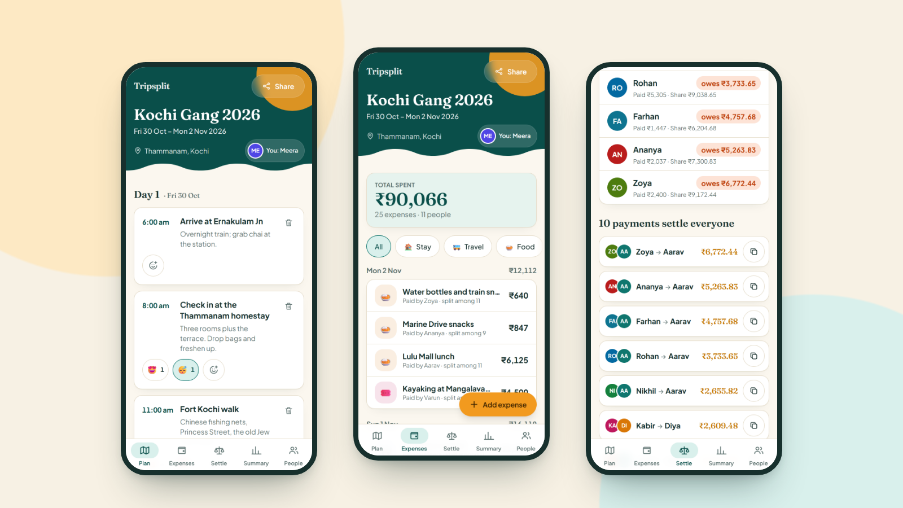

# Tripsplit: design

Product and visual design as built. Values are read from [globals.css](../src/app/globals.css), [layout.tsx](../src/app/layout.tsx) and the components. For behaviour see [prd.md](prd.md); for the rules on changing the UI see [rules.md](rules.md).

## Principles

1. WhatsApp first. The product is a link in a group chat. Sharing is the first thing in the top bar, the Open Graph preview is readable, and the settle-up list is built to paste back into WhatsApp.
2. Zero sign-up. Nobody should hit a form before they see the trip. Identity is a single tap on a name, and viewing needs none.
3. Thumb reach. The five tabs sit at the bottom on a phone. Each screen has one near-black primary pill ("Add expense", "Copy all", "Add"). Destructive actions are small icons or red text buttons away from the main flow, and they confirm first.
4. Numbers are the hero. Money is large, semibold, tabular, and always in rupees with Indian grouping. The sign says what it means, so colour does not have to.
5. People and money, set as themselves. Every person is a stable pale tint with the dark of their own hue as ink. Every category is a pale tile with the dark of its own hue. Teal is kept for data and selected states, about 5% of the pixels, so the people and the figures carry each screen.
6. Honest states. Every screen has a loading, empty and error state in plain words.

## The idea

A trip is a group of friends and the money between them. The design shows those two things as they are: faces as coloured initials, money as big plain figures. There is no decoration to carry the brand. The one element only this product has is the balance river on Settle: one row per person, a bar growing right of a centre zero line for "gets back" and left for "owes", sorted from the biggest creditor to the biggest debtor. The whole group's position reads at a glance, before the list of payments.

What the system deliberately does not have: shadows on anything at rest, backdrop blur or glass, a hero band or wave, a serif, uppercase tracked labels, emoji as interface icons, a floating action button, a donut with the total in the hole, and any violet or indigo.

## Visual language

### Colour tokens

Light is the default; dark applies automatically through `prefers-color-scheme` (there is no toggle). Dark is true neutral grey, with no navy or slate. In Tailwind each token is a class suffix (`bg-surface`, `text-muted`, `border-border`, `divide-rule`).

| Token | Light | Dark | Used for |
| --- | --- | --- | --- |
| `--ground` | `#f3f5f4` | `#0e0f10` | The page (a hair of backwater green in light) |
| `--surface` | `#ffffff` | `#17191a` | Cards, bars, sheets, inputs |
| `--raised` | `#f2f6f5` | `#1e2122` | Inner panels, hover on a surface |
| `--active` | `#e9ecee` | `#2a2d2f` | Neutral selected pill (tab, chip), chart tracks, skeleton bars |
| `--border` | `#e6e6e6` | `#26292b` | 1px border of cards and bars |
| `--rule` | `#f1f2f3` | `#1f2224` | Row dividers inside a card |
| `--control` | `#d6d9dd` | `#3d4144` | Borders of inputs, secondary buttons and chips |
| `--text` | `#1b1d1f` | `#f2f4f5` | Ink |
| `--muted` | `#5c6064` | `#a9aeb2` | Secondary text, inactive tabs |
| `--primary` | `#1b1d1f` | `#f2f4f5` | The one primary button fill (inverts in dark) |
| `--primary-hover` | `#34373a` | `#ffffff` | Primary button on hover |
| `--primary-fg` | `#ffffff` | `#0e0f10` | Label on the primary button |
| `--accent` | `#0f766e` | `#5fd0c2` | Backwater teal: tally and chart fills, links, focus ring, checked boxes |
| `--accent-soft` | `#d7efeb` | `#12332f` | Selected vote pill, "You" pill |
| `--accent-ink` | `#0a4f4a` | `#a7ebe2` | Text and icons on `--accent-soft`, text actions |
| `--positive` | `#2f7a45` | `#5cc983` | "Gets back" amounts, done states |
| `--negative` | `#c41c29` | `#ff7a7a` | Errors, over-assignment, remove and delete text |
| `--warning` | `#92400e` | `#f0b35c` | Warning text |
| `--whatsapp` | `#178a45` | `#25d366` | The WhatsApp glyph only, never a fill |

Status pills are a tinted background with a dark ink of the same hue:

| Pill | Light background / ink | Dark background / ink |
| --- | --- | --- |
| Positive | `#dcfae5` / `#04250e` | `#15291c` / `#5cc983` |
| Negative | `#ffedea` / `#831c1e` | `#2f1618` / `#ff7a7a` |
| Warning | `#fffbeb` / `#92400e` | `#2b2010` / `#f0b35c` |
| Neutral | `#eef1f4` / `#3a3d40` | `#232628` / `#c4c8cb` |

The meta `theme-color` is `#f3f5f4` in light and `#0e0f10` in dark, so the browser bar matches the page. The product mark is the balance river: four bars on a zero line, two growing right in teal for "gets back" and two growing left in ink for "owes", the two sides equal in length. It is the Settle screen's signature element reduced to a symbol, and its shape (not its colour) carries the meaning, so it works in one colour. The favicon ([icon.svg](../src/app/icon.svg)) is redrawn on a 16px grid; `MarkIcon` draws the same mark in `currentColor` next to the wordmark. The full set, the clear space, the minimum size and the two alternative directions are in [brand/README.md](../brand/README.md).

Other fixed values: the sheet scrim is black at 50%, and the sheet is the only surface with a shadow (`0 -8px 32px` black at 18%) because it is the only thing that floats.

### Category colours

Each category has a pale tint with a dark ink of the same hue (icon and label on the tile), and a full-strength chart colour for bars, ring segments and legend dots. All three switch in dark mode: the tint becomes a dark tint of the hue and the ink becomes light. One subject keeps one hue everywhere, so Stay is teal on the row pill, the form tile, the stacked bar and the ring. Travel is cobalt, not indigo.

| Category | Icon | Light tint / ink / chart | Dark tint / ink / chart |
| --- | --- | --- | --- |
| Stay (teal) | home | `#d7efeb` / `#0a4f4a` / `#0f766e` | `#12332f` / `#a7ebe2` / `#5fd0c2` |
| Travel (cobalt) | bus | `#dcebff` / `#0a3a80` / `#1d5fd6` | `#14263f` / `#b3d1ff` / `#6aa2f5` |
| Food (turmeric) | bowl | `#fdecc8` / `#7a3e00` / `#b45309` | `#3a2a0c` / `#f6cf87` / `#e0a23a` |
| Activities (rose) | ticket | `#fde2e7` / `#8a1538` / `#be123c` | `#3c1621` / `#f9b8c8` / `#f06b8e` |

They are the CSS variables `--cat-<name>-tint`, `-ink` and `-chart`, and [categories.ts](../src/components/categories.ts) maps each category to its label, icon and those variables. The icons come from [icons.tsx](../src/components/icons.tsx).

### People palette

Members get a colour in join order from `MEMBER_COLORS` in [types.ts](../src/lib/types.ts), wrapping after 12. Only the hue of the stored hex is used, so older rows with any stored colour still render.

- 12 base hues: 328, 80, 205, 34, 155, 350, 105, 228, 56, 180, 12 and 130 degrees.
- No hue between 245 and 300 degrees, so there is no violet, indigo or purple.
- Neighbours in the list are at least 60 degrees apart, wrap included. The actual minimum is 112.
- A unit test checks all three rules ([member-colors.test.ts](../src/lib/__tests__/member-colors.test.ts)).

A person's colour is always a pale tint with dark ink, never a saturated fill. [person-tint.ts](../src/components/person-tint.ts) turns the hue into CSS variables, and the colour switch for dark mode happens in CSS with no JavaScript:

| | Background | Ink |
| --- | --- | --- |
| Light | `hsl(h 70% 92%)` | `hsl(h 60% 26%)` |
| Dark | `hsl(h 30% 20%)` | `hsl(h 70% 80%)` |

The avatar is that tint with the ink initials, no ring. Where two avatars overlap (payment rows) a 2px ring in the surface colour separates them. One word gives two letters ("Meera" gives "ME"); more words give the first and last initials.

### Typography

One family: Manrope, loaded through `next/font/google` in weights 400, 500 and 600, `display: swap`, latin subset, as the CSS variable `--font-manrope` then `--font-sans`.

| Role | Size and weight | Used for |
| --- | --- | --- |
| Lead (`text-lead`) | 32px / 600, tracking -0.02em | The money figure that leads a screen, the amount field |
| Title (`text-title`) | 24px / 600, tracking -0.02em | Trip name, page titles |
| Section (`text-section`) | 18px / 600 | Card and day headings |
| Body | 16px | Row titles, inputs, paragraphs |
| Small | 14px | Labels, sublines, row line 2, buttons |
| Meta (`text-meta`) | 12px | Pills, chart value labels |

Tab labels are 11px, the one place below 12px. The landing headline is 40px, or 48px from the `lg` breakpoint, at 600. Labels above fields are sentence case, 14px, grey; nothing is uppercase or tracked. Headings use `text-wrap: balance`. Every figure, count and time carries `tabular-nums` (the `num` utility) so digits line up. Inputs are 16px so iOS Safari does not zoom on focus.

### Money signs

The sign carries the meaning, so ordinary amounts need no colour. [money-sign.ts](../src/components/money-sign.ts) makes the text:

| Case | Text | Colour |
| --- | --- | --- |
| Gets back | `+₹1,200` | `--positive` (green) |
| Owes | `−₹1,200` with the true minus sign U+2212 | Ink, never red |
| Zero | `settled` | `--muted` (grey) |

Expense rows and totals are plain ink at 600. Red is kept for errors and for an exact split that is over the total.

### Shape, space and motion

- Radii: cards 20px, inner panels 12px, fields 12px, buttons, chips and pills fully round, small marks (checkboxes, text-action focus shape) 6px. Sheets are 20px on top only on phones and 20px all round from `sm` up.
- Cards are a white surface with a 1px `--border`. There is no shadow at rest and never a border and a shadow together. Inner panels are `--raised` with no border. Rows inside a card are split by 1px `--rule` lines.
- Spacing is on a 4px base, with one gap per screen: 16px on a phone. Page margins are 16px on a phone and 32px gutters from `lg`.
- Buttons, chips and the 44px targets scale to 0.98 when pressed. Sheets rise 24px over 0.2s. Loading bars do not animate. Press scale and the sheet animation switch off under `prefers-reduced-motion`.
- Every control gets the same `:focus-visible` ring: 2px `--accent`, offset 2px. `touch-action: manipulation` is set on the page and on controls, the tap highlight is off, native checkboxes use `accent-color`, and `color-scheme` follows the theme. Native selects have explicit background and text colours so Windows dark mode stays readable.

## Shell

| Width | Layout |
| --- | --- |
| Under 640px | One full-width column, 16px margins, bottom tab bar |
| 640 to 1023px | A centred 720px column, tab bar kept |
| 1024px and up | A 240px left sidebar and a canvas of up to 1100px of content with 32px gutters |

The trip layout is [layout.tsx](../src/app/t/%5Bslug%5D/layout.tsx). Every trip page sits in one `trip-column`, so a page never sets its own max width. Screens with two natural columns use `wide-2col` (two equal columns) or `wide-2col-aside` (main plus a 360px aside), both stacked below `lg`. The expense form keeps a slim bar and a sticky save bar.

## Components

| Component | Look and behaviour | Source |
| --- | --- | --- |
| Top bar | 56px, on `--ground`, no fill band and no wave. Left: the balance-river mark and "Tripsplit" at 16px/600, linking home. Right: Share as a secondary pill (white, 1px control border, share icon). From `lg` the brand moves to the sidebar. | [trip-header.tsx](../src/components/trip-header.tsx) |
| Title row | Under the top bar: the trip name as the h1, then a grey subline "date range · base · 11 people". A "You: Meera" pill with the person's avatar links to People once identified. This replaces the old hero. On add and edit expense pages the header is a slim bar with a back chevron and the trip name. | [trip-header.tsx](../src/components/trip-header.tsx) |
| Tab bar and sidebar | Phone: fixed to the bottom, opaque white with a 1px top border, no blur, five equal tabs (Plan, Expenses, Settle, Summary, People), at least 64px tall plus the safe-area inset. The active tab has ink text and a neutral `--active` pill behind the icon; inactive tabs are `--muted`; `aria-current="page"`. From `lg` it becomes a 240px labelled left rail on `--ground` with the brand, 40px rows, 16px icons, and a grey `--active` pill on the current row. Hidden on phone on expense form pages, which have their own save bar. | [tab-bar.tsx](../src/components/tab-bar.tsx) |
| Card and panel | Card: white surface, 20px radius, 1px border, no shadow. Panel: 12px radius on `--raised`, for the vote block and previews. | globals.css |
| Chips | 44px pill, 1px control border. Selected (`data-active` or `aria-pressed`) is the grey `--active` fill with a semibold label. Filters sit in a horizontally scrolling `chip-row` with no scrollbar. | globals.css |
| Pills | 24px read-only labels with 12px text. Neutral by default; positive, negative, warning and accent tones. A category pill uses the category tint and ink with a 12px icon. | globals.css |
| Buttons | `btn-primary` is the near-black pill, one per screen. `btn-secondary` is white with a 1px control border (Share, Lock in, WhatsApp). `btn-ghost` is borderless, for icon buttons and quiet actions such as All and None. `btn-danger` is tonal red. All are 44px tall, fully round, 14px/600. | globals.css |
| Fields | 44px tall, 12px radius, 16px text, 1px control border that turns accent on focus and red when `aria-invalid`. Labels are sentence case 14px grey. | globals.css |
| Sheet | Bottom sheet on phones and centred card on desktop, max height 88dvh, opaque scrim, backdrop tap or Escape closes, page scroll locks while open and `overscroll-behavior: contain` stops scroll chaining. Used for "Invite the gang" (Copy link is the primary action, WhatsApp is secondary with a green glyph) and "Who are you?". | [sheet.tsx](../src/components/sheet.tsx) |
| Avatar | Pale tint of the person's hue with ink initials, sizes 28, 40 and 56px, `aria-hidden` because the name is always next to it. | [avatar.tsx](../src/components/avatar.tsx) |
| Category tile and pill | Form: four tiles with the category tint, a 22px line icon and a 14px label in the category ink. Lists and filters: a small pill or chip with a 12px or 18px icon. No emoji. | expense-form.tsx, expense-list.tsx |
| Identity banner | A card above the page content: "Who are you?" and a scrolling row of chips, each with the person's avatar, plus an "I'm not on the list" chip. | [identity.tsx](../src/components/identity.tsx) |
| Charts | Library-free. A 100% stacked category bar (expense list), a thin ring, bullet rows and day columns ([bars.tsx](../src/components/bars.tsx)), and the balance river on Settle. Each has a text equivalent for screen readers. | bars.tsx, settle page |
| Skeletons | Flat `--active` bars at the real size inside cards, no animation, announced with `aria-busy`. The shell skeleton has the same frame as the real shell. | [skeletons.tsx](../src/components/skeletons.tsx) |
| Icons | 34 inline SVGs in one file, drawn on a 24 grid with a 1.75 stroke in `currentColor`, 22px by default. `MarkIcon` is the one filled icon. | [icons.tsx](../src/components/icons.tsx) |

## Screens

Screenshots are in [docs/screenshots](screenshots/): `hero.png` (plan, expenses and settle side by side), `plan.png`, `expense-form.png`, `settle.png`, `summary.png`. Each screen answers one question, and the biggest thing on it answers it.

### Landing (`/`)

Built with tasteskill v2 in the "split-stage" direction (seed 1913576966; the sheet is in `.taste-skill/`). One font (Manrope) on four steps from `src/components/landing/type.ts`: display, title, lead (20px) and body (16px). One pair of outer margins: 16px on a phone, 24px from tablet up.

- Hero: from `lg`, two halves. On the left a surface panel with the colour stripe (one cell per person tint), the wordmark, "Plan the trip. Split the bill.", one sentence, a near-black "Create a trip" and three underlined links (Open the demo trip, How it works, What it does). On the right a sticky stage with three Kerala photographs. Below `lg` the wordmark is a top bar, the photograph comes first and the panel overlaps its foot.
- "What the group gets": four outputs (The day plan, Every bill, Who pays whom, The message for the group). Picking one swaps the stage to that real sheet, rendered as live markup from the demo data. On a phone the four names wrap; they never scroll sideways.
- "What's included": a receipt on the accent-soft band, with dotted leaders between each feature and its figure.
- "How it works": three steps (Drop one link in the group, Add what you spend, Settle in a few payments), each beside a cropped interface fragment that pins while its text scrolls.
- "Create a trip": the form (Trip name, Where are you staying?, Starts, Ends, Your name, The others). The submit reads "Creating…" while pending.
- Footer: the fishing-net photograph beside a large menu, the photo credits, a note that the demo people are made up, and "© 2026 Steve Mathai Mathew. All rights reserved."

Photographs are Wikimedia Commons files listed in `public/photos/credits.json`. They are shown whole at their own aspect ratio on a flat field, `unoptimized`: no crop, zoom, tint, mask or overlay (the owner's rule). The interface fragments carry `data-ui` so the inspector measures them as product, not page type. The page is static (no database read).

### Plan (`/t/<slug>`)

"What are we doing each day, and what is undecided?" A row of day chips under the title (Fri 30, Sat 31, Sun 1, Mon 2) jumps to each day; from `lg` it becomes a "Jump to a day" list beside the plan. Each day has a heading such as "Day 1 · Fri 30 Oct" at 18px/600 and a grey count ("6 plans, 1 vote open"), then one white card with a row per item. A plan row has the time in a fixed 64px left column (grey "Any time" when untimed), the title at 16px/600, grey notes, and a trash icon and an add-reaction button at the right, each with a 44px hit area. Reactions are compact neutral chips (emoji and count), shown only when someone used them.

Options for the same day and time become one vote block inside the day card: a `--raised` panel headed "Vote · 8:00 pm" with "2 options" on the right. Each option has its title, a 6px tally bar (yes share of the whole group, accent on a `--active` track), and "5 in · 1 out of 11". The leading option's "in" count is ink at 600. Below are thumb-up and thumb-down pills with counts (selected is `--accent-soft` with `--accent-ink`) and a secondary "Lock in" pill. The foot of every day card has a secondary "Add to Day 1" button that opens an inline form (Time, Place, Notes, the option checkbox, Cancel and Add). Key interactions: vote and reaction taps update at once; tapping your own vote again clears it; hovering a chip shows who voted through its title text (desktop only). Emoji reactions stay as emoji because they are user content.

### Expenses (`/t/<slug>/expenses`)

"What have we spent, and on what?" A lead card holds "Total spent", the amount at 32px/600, "25 expenses · ₹8,187.82 a head", a 10px stacked bar split by category (2px seams, category colours) and four legend rows (dot, name, amount, share). Under it is the filter chip row: All, Stay, Travel, Food, Activities, with line icons; the total and per-head follow the filter, the bar and legend always cover everything. From `lg` the lead card and filter sit in a sticky 360px column beside the list.

The section header "All expenses" has the near-black "Add expense" pill at its right and is sticky at the top of the screen on `--ground` while the list scrolls, so the main job is always one tap away and covers no row. There is no floating button. Expenses are grouped by day under "Mon 2 Nov" with the day total on the right. Rows share one white card per day at 64px or more: the payer's 40px avatar, the description (truncated) and the amount at 16px/600, and a second line with the category pill and "Paid by Zoya". A row opens the edit page.

### Add or edit expense (`/t/<slug>/expenses/new`, `/expenses/<id>`)

A full page, not a sheet, with a slim top bar (back chevron and trip name) and a sticky save bar. The h1 is "Add expense" or "Edit expense"; edit mode adds a red "Delete" text button that confirms first. Cards in order: amount (a grey ₹ prefix and the input at 32px/600 tabular, an error line only when the text is not an amount, then "What was it for?"); category (four equal pale tiles, two by two on a phone and in one row from `sm`, the selected tile gets a 2px ring in its own ink) with Paid by and Date as two 44px selects side by side; then Split. From `lg` the form is two columns: amount and category on the left, Split on the right.

The Split card has a segmented control (Equally, Exact, Shares: a pill track with a white active pill), a one-line hint per mode, All and None text buttons, and one row per member with a checkbox, a small avatar, the name and the computed share in grey. The right side of each row changes by mode: the person's amount (Equally), a right-aligned amount field (Exact), or minus and plus buttons around a count (Shares), with the per-head amount under the name. Exact mode adds a live line: "₹X left to assign" in grey, "₹X over the total" in red, "All assigned" in green, plus "Fill evenly". The sticky bar shows any error and a full-width near-black pill, "Add expense · ₹4,180" or "Save changes". At `lg` it starts after the sidebar.

### Settle (`/t/<slug>/settle`)

"Who pays whom, and how much?" The title is "10 payments settle everyone" (the count is computed) with one sentence found in the data, for example "Most money goes back to Aarav, who is owed ₹24,729.47 after paying ₹27,500 for the homestay."

The balance river is the signature element. One card, one row per person: avatar and name, a track around a centre zero line, and the amount. A creditor's bar grows right in `--accent`, a debtor's grows left in ink at 70%, and both use one scale, the largest balance on the trip. The amount is the signed figure (`+₹x`, `−₹x`, or a grey "settled" with no bar). Rows are sorted from the biggest "gets back" to the biggest "owes". A visually hidden table carries the same data for screen readers.

Then "Payments" in one white card: two overlapping 28px avatars, "Zoya pays Aarav", the amount at 16px/600 ink, and an icon button that copies the line and announces "Copied". If the receiver has a UPI id a "Pay ₹6,772 via UPI" text link sits under the line. Under the card, "Copy all" (primary) and "Send on WhatsApp" (secondary, with the glyph in its own green), then a note that this is the fewest payments. "Paid and share" lists each person with "Paid ₹X · Share ₹Y" and their signed balance. From `lg` the river and "Paid and share" are on the left and the payments on the right.

### Summary (`/t/<slug>/summary`)

"Where did the money go?" A lead card has "Total spent" at 32px/600 and "₹8,187.82 a head · 25 expenses · 4 days". "Where the money went" is a thin 150px ring (about 11px stroke, 2px gaps, no labels on slices, the top category's share in the hole) beside a table of category, amount and share, with the category colours as dots. "Per person" is a bullet row for each member: the accent bar is the share consumed, a 2px ink tick on the same track is what they paid, and a legend under the heading explains both marks once. Rows are sorted by share and say "Paid ₹X" or "Paid nothing". "Per day" is a column per day in one hue (`--accent`), with the value on top, the label ("Fri 30") below, no gridlines, and sideways scrolling on long trips. From `lg` the categories are on the left and the other two cards on the right.

### People (`/t/<slug>/people`)

"Who is on the trip?" A short explanation, then one white card with a row per person: 40px avatar, name, a "You" pill on the current person, and the UPI id in grey (or "No UPI id"). Row actions are text buttons: "This is me", "Edit UPI id" (opens an inline field with Save and Cancel) and a red "Remove", which opens a panel asking "Remove Zoya from the trip?" first. "Add someone" is a card with a name field and a near-black Add button, below the list on a phone and in a 360px column from `lg`.

### Trip shell, share and identity

The trip layout wraps every tab with the top bar, the title row, the identity banner (when needed) and the tab bar or sidebar. "Share" opens "Invite the gang": the full link in a panel, "Copy link" (primary), "Share on WhatsApp", and "More apps" when the browser can share natively.

## States

| State | What the user sees |
| --- | --- |
| Loading a trip | The shell skeleton (sidebar column at `lg`, top bar, title bars, cards), then per-route flat bars inside cards: 4 on Plan, 5 slim on Expenses, 4 on Settle, 4 tall on Summary, 1 tall on People, 3 on the expense form |
| Empty day | "Nothing here yet. Add the first thing." |
| No expenses | "No expenses yet. Add the first one and the maths takes care of itself." A category filter with no matches says "No food expenses yet." The page frame stays |
| Everyone square | Heading "Everyone is settled", no river and no payments, only the "Paid and share" list |
| No expenses in Summary | Per-day card says "No expenses yet." and the ring is an empty track with nothing in the hole |
| No identity | The "Who are you?" banner; tapping a vote opens the same picker as a sheet. The expense form hides the banner and defaults Paid by to the first member |
| Saving | Buttons change label and disable ("Saving…", "Adding…", "Creating…", "Joining…", "Removing…"); rows and cards dim to 60 to 80% while an action runs |
| Field or server error | Red text in a `role="alert"` element next to the action that failed, written in plain words ("Someone called Zoya is already on this trip") |
| Unexpected error | The mark, "Something went wrong", "Your trip is safe. Try again in a moment.", "Try again" and (at the root) "Back to Tripsplit". The real error goes to the console |
| Unknown trip link | The mark, "Trip not found", "Check the link your friend sent, or start a new trip." (HTTP 200, see [architecture](architecture.md#request-flow)) |
| Dark mode | Same layout with the dark tokens; follows the phone's setting. People and category tints become dark tints with light ink |

## Accessibility

What is done:

- Votes and reactions are toggle buttons with `aria-pressed` and labels that carry the count ("Vote yes, 4 so far"). The reaction picker is a labelled group; the add-reaction button has `aria-expanded`.
- Form fields have visible labels or `aria-label`s ("Amount for Meera", "UPI id for Zoya"). The category choice and the split mode are each a `radiogroup`, and member rows are `checkbox` roles.
- The exact-amount balance line, the vote tally and the "Copied" state are `aria-live`. Errors are `role="alert"`.
- Sheets are `role="dialog"` with `aria-modal`, a visible Close button, Escape to close, and page scroll lock.
- The tab bar is a labelled `nav` and marks the current page. Decorative icons, emoji and avatars are `aria-hidden`. The ring, the bullet rows and the stacked bar have `role="img"` labels, the day columns and the balance river have a text twin for screen readers, and charts never rely on colour alone (every segment has a printed amount).
- Money signs are in the text itself (`+`, `−`, "settled"), so the meaning survives without colour.
- Every control shows the same 2px focus ring, and icon-only buttons have `aria-label`s.
- Safe-area insets are applied to the top bar, tab bar, sheets and the expense save bar. The viewport uses `viewport-fit=cover`.
- Reduced motion switches off the press scale and the sheet animation.
- `lang="en-IN"` on the page.

Contrast, computed with the WCAG formula from the token values in [globals.css](../src/app/globals.css) (4.5 is the AA minimum for body text, 3 for icons, chart marks and large text). Each cell is light then dark:

| Pair | Ratio (light, dark) |
| --- | --- |
| Ink on ground | 15.4 and 17.4 |
| Ink on surface | 16.9 and 16.0 |
| Muted on surface | 6.3 and 7.9 |
| Muted on ground | 5.8 and 8.6 |
| Muted on `--raised` | 5.8 and 7.2 |
| Muted on `--active` | 5.3 and 6.2 |
| Primary button label on its fill | 16.9 and 17.4 |
| Accent on surface (focus ring, links) | 5.5 and 9.5 |
| Accent on ground | 5.0 and 10.3 |
| Accent ink on accent soft | 7.8 and 10.1 |
| `+₹` green on surface | 5.3 and 8.5 |
| `+₹` green on ground | 4.8 and 9.3 |
| Red on surface (errors, Remove) | 5.9 and 7.0 |
| Positive pill | 14.8 and 7.4 |
| Negative pill | 8.6 and 6.7 |
| Warning pill | 6.8 and 8.6 |
| Neutral pill | 9.6 and 9.0 |
| Category ink on its tint (lowest of four) | 7.2 (Food) and 9.4 (Food) |
| Category chart colour on surface (lowest of four) | 5.0 (Food) and 6.1 (Activities) |
| Person ink on person tint (lowest of the 12 hues) | 5.6 (hue 56) and 7.2 (hue 228) |
| WhatsApp glyph on surface | 4.4 and 8.9 |
| Control border on surface | 1.4 and 1.7 |

Known gaps: the control border (inputs, secondary buttons, chips) is far below the 3:1 that WCAG 1.4.11 asks for on component outlines, in both themes; the label, text and placement identify each control, but the outline alone does not. Tab labels are 11px. Sheets do not trap focus or return it to the trigger. Vote chips explain who voted only through a `title`, which touch screens do not show. There is no skip link.

## Design checks (21 Nov 2026)

The tasteskill inspector ran on a production build (`next start`) at 1440, 768 and 390px. Landing with the page rules, each trip screen with `--app`, and Plan with `--allow emoji` because the emoji there are user reactions, not interface. All screens: 0 FAIL. The WARNs that remain are kept on purpose:

| Screen | WARN | Why it stays |
| --- | --- | --- |
| Landing | no-footage | No honest clip of a group splitting a bill; the three photographs carry the place. |
| Landing | off-centre, blank-gap | The hero photographs sit whole at their own ratio on a flat field, so the stage has empty bands beside them. Cropping to fill would break the no-crop rule. |
| Plan | below-fold | A trip is long; the day chips and "Jump to a day" list reach the rest. |
| Expense form | icon-chips | The pastel category tiles are the style's one move for categories. |
| Expense form, Settle, Summary, People | ragged-row | The side column is shorter than the main list by nature. |
| Not found | hero-void | A short message on an empty page is the right weight for a dead link. |

The web-design-guidelines, mobile-native (390px) and break-ui passes were done on the trip screens; their fixes are in the code (skip link, sheet focus, autocomplete, line clamps, grapheme-safe initials, a screen-reader table for Settle, phone plan rows). Before and after screenshots are in `brand/screens/before/` and `brand/screens/after/` (1440 and 390px, light and dark). Phone hardware was not tested.

## Copy tone

Plain, friendly, a little playful, never jokey about money. Short sentences, second person, Indian English, ₹ with lakh grouping, dates like "Fri 30 Oct" and times like "6:00 am". Sentence case everywhere, and no new dashes in user-facing strings.

| Instead of | The app says |
| --- | --- |
| "Invalid split: sum mismatch" | "₹40 left to assign" |
| "Error 500" | "Something went wrong" |
| "404" | "Trip not found" |
| "Authenticate" | "Who are you?" |
| "Debt simplification" | "4 payments settle everyone" |
| "No records" | "No expenses yet" |

Buttons start with a verb ("Lock in", "Add to Day 1", "Copy all", "Send on WhatsApp"). Pending labels end with an ellipsis ("Saving…"). The trip share message is "Join our trip <name> on Tripsplit: <url>". Demo people and places are real-feeling but made up, with no UPI ids.
