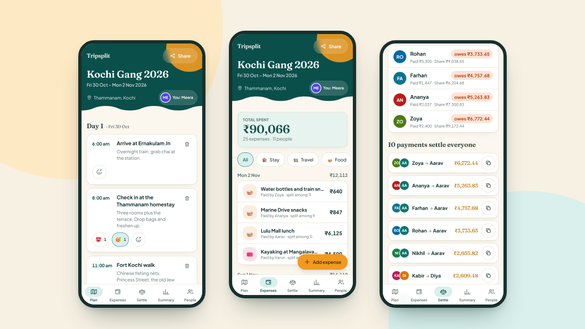

# Tripsplit: design

Product and visual design as built. Values are read from [globals.css](../src/app/globals.css), [layout.tsx](../src/app/layout.tsx) and the components. For behaviour see [prd.md](prd.md); for the rules on changing the UI see [rules.md](rules.md).

## Principles

1. WhatsApp first. The product is a link in a group chat. Sharing is the first thing in the header, the Open Graph preview is readable, and the settle-up list is built to paste back into WhatsApp.
2. Zero sign-up. Nobody should hit a form before they see the trip. Identity is a single tap on a name, and viewing needs none.
3. Thumb reach. The five tabs sit at the bottom, the primary action ("Add expense", "Add") is a wide saffron pill, destructive actions are small icons away from the main flow and confirm first.
4. Numbers are the hero. Money is large, set in the display serif, tabular, and always in rupees with Indian grouping.
5. Warm, not corporate. Backwater teal, saffron and warm paper, with rounded shapes and a wave in the header, so it feels like a trip and not a spreadsheet.
6. Honest states. Every screen has a loading, empty and error state in plain words.

## Visual language

### Colour tokens

Light is the default; dark applies automatically through `prefers-color-scheme` (there is no toggle).

| Token | Light | Dark | Used for |
| --- | --- | --- | --- |
| `--paper` | `#fbf7ef` | `#0d1a19` | Page background |
| `--card` | `#ffffff` | `#152624` | Cards, fields, sheets |
| `--card-soft` | `#f5efe2` | `#1b312e` | Track backgrounds, skeletons, soft panels |
| `--ink` | `#17302d` | `#e9f2ef` | Body text |
| `--muted` | `#5d7270` | `#93aca8` | Secondary text, inactive tabs |
| `--line` | `#e7dfce` | `#26413d` | Borders and dividers |
| `--primary` | `#0f766e` | `#2dd4bf` | Primary buttons, focus ring, active chips |
| `--primary-deep` | `#0a4f4a` | `#99f6e4` | Active tab text, key figures |
| `--primary-soft` | `#d9f0ec` | `#123a36` | Active chip and tab backgrounds |
| `--hero` | `#0a4f4a` | `#0b3a36` | Header and landing hero |
| `--accent` | `#f29a1f` | `#fbbf24` | Saffron: the main call to action, option badge, header sun |
| `--accent-deep` | `#c97a06` | `#fcd34d` | Saffron text on light backgrounds, transfer amounts |
| `--accent-soft` | `#fde9c4` | `#3d2f10` | Option cards, the identity banner, "Per head" stat |
| `--good` / `--good-soft` | `#15803d` / `#dcf5e3` | `#4ade80` / `#12301e` | "gets back", up-votes, copied state |
| `--bad` / `--bad-soft` | `#c2410c` / `#fde3d6` | `#fb923c` / `#3a1f12` | "owes", down-votes, errors, delete |

The meta `theme-color` is `#0f766e` in light and `#0d1a19` in dark. The app icon ([icon.svg](../src/app/icon.svg)) is a `#0f766e` rounded square with a `#0a4f4a` wave, a `#f29a1f` sun and a `#fbf7ef` paper-plane shape.

Fixed colours that do not change in dark mode: WhatsApp green `#25d366` with `#052e16` text; the sheet backdrop `#0a1f1d` at 55%; the saffron button text `#3a2200`; the category and avatar palettes below. In dark mode `btn-primary` switches its text to `#052e2a`.

Category colours (donut and bars, [categories.ts](../src/components/categories.ts)): Stay `#0f766e` with 🏠, Travel `#4f46e5` with 🚌, Food `#d97706` with 🍛, Activities `#be185d` with 🎟️.

Avatar palette, handed out in join order and wrapping after 12 ([types.ts](../src/lib/types.ts)): `#0f766e`, `#d97706`, `#be185d`, `#4f46e5`, `#15803d`, `#b91c1c`, `#0369a1`, `#7e22ce`, `#c2410c`, `#4d7c0f`, `#0e7490`, `#a21caf`. Initials are white, or `#17302d` when the colour's perceived luminance is above 0.62, so any future colour stays legible. One word gives two letters ("Meera" gives "ME"), more gives first and last initials.

### Typography

Both fonts load through `next/font/google` with `display: swap`, latin subset.

| Role | Font | CSS variable | Used for |
| --- | --- | --- | --- |
| Body and UI | Plus Jakarta Sans | `--font-jakarta` then `--font-sans` | All text by default |
| Display | Fraunces (serif) | `--font-fraunces` then `--font-display` | Brand wordmark, headings, big money figures, day headings |

Key sizes: landing headline 2.6rem (3rem from the `sm` breakpoint), trip title 1.9rem, section headings `text-xl`, body 16px, labels 12px uppercase with wide tracking, tab labels 11px. Inputs are `text-base` (16px) so iOS Safari does not zoom on focus. Money uses `tabular-nums` so digits line up.

### Shape, space and motion

- Content column: max width 640px, centred, 16px side padding.
- Radii: cards `rounded-2xl` (16px), fields `rounded-xl`, buttons and chips `rounded-full`, sheets `rounded-t-3xl` on phones and `rounded-3xl` on desktop.
- Card shadow: `0 1px 0 rgb(23 48 45 / 0.03), 0 8px 24px -16px rgb(23 48 45 / 0.18)`, on a 1px `--line` border.
- Motion is small: buttons scale to 0.97 when pressed; sheets rise 24px over 0.22s; skeletons shimmer for 1.3s per cycle. Both animations switch off under `prefers-reduced-motion`.

## Components

| Component | Look and behaviour | Source |
| --- | --- | --- |
| Header with wave | `--hero` block with a saffron circle bleeding off the top right and a wave path in the paper colour along the bottom. Holds wordmark (links home), Share button, trip name, date range, base location with a pin, and a "You: Name" pill. On add and edit expense pages it shrinks to a 56px bar with just the trip name. | [trip-header.tsx](../src/components/trip-header.tsx) |
| Bottom tab bar | Fixed to the bottom, five equal columns (Plan, Expenses, Settle, Summary, People), 64px tall plus the safe-area inset. The active tab has a `--primary-soft` pill behind its icon and `--primary-deep` text; `aria-current="page"`. Hidden on expense form pages, which have their own save bar. | [tab-bar.tsx](../src/components/tab-bar.tsx) |
| Card | White surface, 16px radius, border and soft shadow (`card` utility). | globals.css |
| Chips | 44px pill. `data-active="true"` turns it teal. Category filters sit in a horizontally scrolling `chip-row` that fades out at the right edge. Vote chips go green or orange when active. | globals.css |
| Buttons | `btn-primary` (teal), `btn-accent` (saffron, the one main action per screen), `btn-soft`, `btn-ghost`, `btn-danger`. 44px minimum height, fully rounded. | globals.css |
| Fields | 44px tall, 16px text, teal border and 2px ring on focus. Labels are small uppercase. | globals.css |
| Sheet | Bottom sheet on phones and centred card on desktop, max height 88dvh, backdrop tap or Escape closes, page scroll locks while open. Used for "Invite the gang" and "Who are you?". | [sheet.tsx](../src/components/sheet.tsx) |
| Avatar | Coloured circle with initials, sizes 28, 40 and 56px, `aria-hidden` because the name is always next to it. | [avatar.tsx](../src/components/avatar.tsx) |
| Category tiles | Four large tiles (emoji over label) in a radio group on the expense form; small emoji badges on list rows. | expense-form.tsx, expense-list.tsx |
| Identity banner | Saffron-tinted card above the page content with a scrolling row of name chips and a dashed "I'm not on the list" chip. | [identity.tsx](../src/components/identity.tsx) |
| Charts | Horizontal bars (with an optional second-measure tick) and a donut, both server-rendered and library-free. | [bars.tsx](../src/components/bars.tsx) |
| Skeletons | Shimmering blocks sized per route, announced with `aria-busy`. | [skeletons.tsx](../src/components/skeletons.tsx) |
| Icons | 22 inline SVGs in one file (map, wallet, scale, chart, users, share, WhatsApp, UPI and so on). Tab icons are 22px. | [icons.tsx](../src/components/icons.tsx) |

## Screens

Screenshots are in [docs/screenshots](screenshots/): `hero.png` (plan, expenses and settle side by side), `plan.png`, `expense-form.png`, `settle.png`, `summary.png`.

### Landing (`/`)

Teal hero with the wordmark and the headline "Plan the trip. / Split the bill. / Stay friends." ("Stay friends." in saffron), one sentence of explanation, and two buttons: saffron "Open the demo trip (Kochi, 11 friends)" and a translucent "Start a trip" that scrolls to the form. Below: three feature cards (Plan together, Split fairly, Settle in a few taps), the "Start a trip" card, and a footnote: "Anyone with a trip link can view and edit it, so share it only with your group." Form labels: Trip name, Where are you staying?, Starts, Ends, Your name, The others. The submit button says "Creating..." while pending. This page is static (no database read).

### Plan (`/t/<slug>`)

One section per trip day with a serif heading ("Day 1" and the short date in muted text). Each item is a card: time on the left in teal ("6:00 am", or muted "Any time"), title and notes, a trash icon top right, then a row of reaction chips and a smiley-plus button. Options get a saffron-tinted card, an "Option" badge, 👍 and 👎 counts and a full-width "Lock it in" button. Under each day, a dashed "Add plan" button opens an inline card form (Time, Place, Notes, the option checkbox, Cancel and Add). Key interactions: vote and reaction taps update at once; tapping your own vote again clears it; hovering a chip shows who voted through its title text (desktop only).

### Expenses (`/t/<slug>/expenses`)

A teal-tinted summary card ("Total spent", the amount at 4xl in the display serif, "25 expenses · 11 people"), the filter chip row, then expenses grouped by day under a heading with the day's subtotal. A row is a 64px tap target: category badge, description, "Paid by X · split among N", amount. A floating saffron "Add expense" pill sits just above the tab bar at the right edge, and the list has bottom padding so the last row is never hidden behind it.

### Add or edit expense (`/t/<slug>/expenses/new`, `/expenses/<id>`)

A full page, not a sheet, with a back button and a slim header. Cards in order: amount (₹ sign, 4xl number, a formatted echo underneath, then "What was it for?"); category tiles, then Paid by and Date selects side by side; Split. The split card has a segmented control (Equally, Exact, Shares), a one-line hint per mode, All and None chips, and one row per member with a checkbox, avatar and name. The right side of each row changes by mode: the person's amount (Equally), an amount field (Exact), or minus and plus buttons around a count (Shares), with the per-head amount under the name. Exact mode adds a live line ("₹X left to assign", "₹X over the total", "All assigned") and a "Fill evenly" chip. A sticky bottom bar shows any error and the saffron button "Add expense · ₹4,180" (or "Save changes"). Edit mode adds a red delete icon beside the title.

### Settle (`/t/<slug>/settle`)

"Balances": a card list, one row per person with avatar, name, a pill ("gets back ₹N" green, "owes ₹N" orange, "settled up" grey) and a muted "Paid ₹X · Share ₹Y". Then "N payments settle everyone": a card per transfer with two overlapping avatars, "Payer → Receiver", the amount in saffron serif, and a copy icon button; if the receiver has a UPI id there is a small "Pay via UPI" button. Below, two buttons: "Copy all" and a WhatsApp-green "Send on WhatsApp", then a note that this is the fewest payments and where UPI ids are added.

### Summary (`/t/<slug>/summary`)

Three stat tiles in one row (Total spend teal, Per head saffron, Expenses neutral). "Where the money went": a donut with the total in the centre, then labelled category bars with amount and percentage. "Per person": a bar for each member's share with a saffron tick for what they paid and a "Paid ₹X" note. "Per day": a bar per day.

### People (`/t/<slug>/people`)

A short explanation, then a card per person: avatar, name, "This is you" (teal outline on the current member), a "This is me" button for others, a remove icon only when allowed, and a UPI field whose Save button appears once the text changes. At the bottom, an "Add someone" card with a name field and a saffron Add button.

### Trip shell, share and identity

The trip layout wraps every tab with the header, the identity banner (when needed) and the tab bar. "Share" opens "Invite the gang": the full link in a box, "Share on WhatsApp", "Copy link", and "More apps" when the browser can share natively.

## States

| State | What the user sees |
| --- | --- |
| Loading a trip | Header skeleton and shimmer cards (`ShellSkeleton`), then per-route skeletons: 4 cards on Plan and People, 5 slim rows on Expenses, 4 on Settle, 4 tall on Summary, 3 on the expense form |
| Empty day | "Nothing planned yet. Add the first thing." |
| No expenses | "Nothing here yet" and "Add the first expense and the maths takes care of itself." (also shown for a category filter with no matches) |
| Everyone square | Heading "Everyone is settled up", no payment cards |
| No expenses in Summary | Per-day section says "No expenses yet." and the donut is an empty ring |
| No identity | The "Who are you?" banner; tapping a vote opens the same picker as a sheet. The expense form hides the banner and defaults Paid by to the first member |
| Saving | Buttons change label ("Saving...", "Adding...", "Creating...") and disable; cards dim to 70 to 80% while an action runs |
| Field or server error | Red text in a `role="alert"` element next to the action that failed, written in plain words ("Someone called Zoya is already on this trip") |
| Unexpected error | 🌧️ "Hit a pothole" with "Try again" and "Back to Tripsplit". The real error goes to the console |
| Unknown trip link | 🧭 "Lost the trail", "We could not find that trip. Check the link your friend sent, or start a new one." (HTTP 200, see [architecture](architecture.md#request-flow)) |
| Dark mode | Same layout with the dark tokens; follows the phone's setting |

## Accessibility

What is done:

- Votes and reactions are toggle buttons with `aria-pressed` and labels that carry the count ("Vote yes, 4 so far"). The reaction picker is a labelled group; the add-reaction button has `aria-expanded`.
- Form fields have visible labels or `aria-label`s ("Amount for Meera", "UPI id for Zoya"). The category choice is a `radiogroup`, member rows are `checkbox` roles, split mode is a `tablist` with `aria-selected`.
- The exact-amount balance line and the "Copied" state are `aria-live`. Errors are `role="alert"`.
- Sheets are `role="dialog"` with `aria-modal`, a visible Close button, Escape to close, and page scroll lock.
- The tab bar is a labelled `nav` and marks the current page. Decorative icons, emoji and avatars are `aria-hidden`; chart bars and the donut have `role="img"` labels.
- Safe-area insets are applied to the header (top), tab bar, sheets and the expense save bar (bottom). The viewport uses `viewport-fit=cover`.
- Reduced motion switches off the skeleton shimmer and sheet animation.
- `lang="en-IN"` on the page.

Contrast, computed with the WCAG formula from the token values (4.5 is the AA minimum for body text):

| Pair | Ratio |
| --- | --- |
| Ink on paper, light and dark | 13.1 and 15.6 |
| Muted on paper, light and dark | 4.8 and 7.4 |
| White on primary teal | 5.5 |
| Saffron button text `#3a2200` on `#f29a1f` | 6.7 |
| "owes" red on its pill background | 4.23 (small, bold) |
| "gets back" green on its pill background | 4.35 (small, bold) |
| Muted on `--card-soft` | 4.46 |
| Saffron text `#c97a06` on white (transfer amounts) | 3.35 |
| Saffron text `#c97a06` on `--accent-soft` ("Per head" tile) | 2.8 |

Known gaps: the two saffron-text pairs, the two pill pairs and muted text on `--card-soft` are below 4.5 in light mode (dark mode passes everywhere, lowest 6.5). Sheets do not trap focus or return it to the trigger. Vote chips explain who voted only through a `title`, which touch screens do not show. A few controls are 36px tall instead of 44px (the "Pay via UPI" button, and the All, None and Fill evenly chips). The split mode `tablist` has no matching `tabpanel`. There is no skip link.

## Copy tone

Plain, friendly, a little playful, never jokey about money. Short sentences, second person, Indian English, ₹ with lakh grouping, dates like "Fri 30 Oct" and times like "6:00 am".

| Instead of | The app says |
| --- | --- |
| "Invalid split: sum mismatch" | "₹40 left to assign" |
| "Error 500" | "Hit a pothole" |
| "404" | "Lost the trail" |
| "Authenticate" | "Who are you?" |
| "Debt simplification" | "4 payments settle everyone" |
| "No records" | "Nothing here yet" |

Buttons start with a verb ("Lock it in", "Add plan", "Copy all", "Send on WhatsApp"). The trip share message is "Join our trip <name> on Tripsplit: <url>". Demo people and places are real-feeling but made up, with no UPI ids.
